Six fully procedural materials built in **Substance Designer** and rendered in **Unreal Engine**. Each material has two states driven by exposed parameters — **Fresh** and **Rotten** — so the same graph can age from lush and saturated to dry, faded and decayed. Every material outputs Base Color, Normal and a packed RAM map (Roughness / AO / Metallic), plus Opacity where needed.

## Cactus / Jade

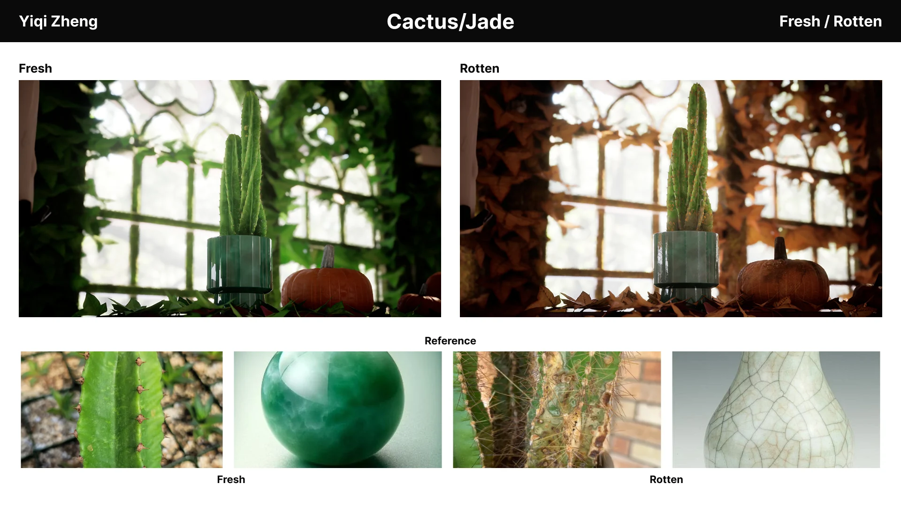

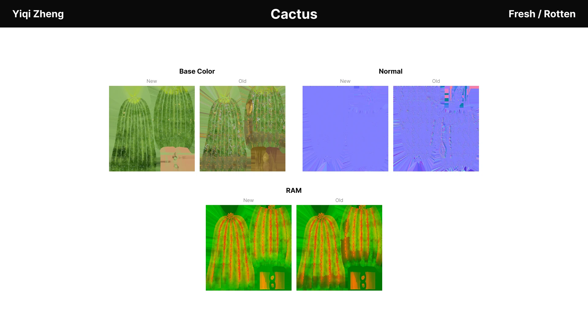

## Leaves / Vine

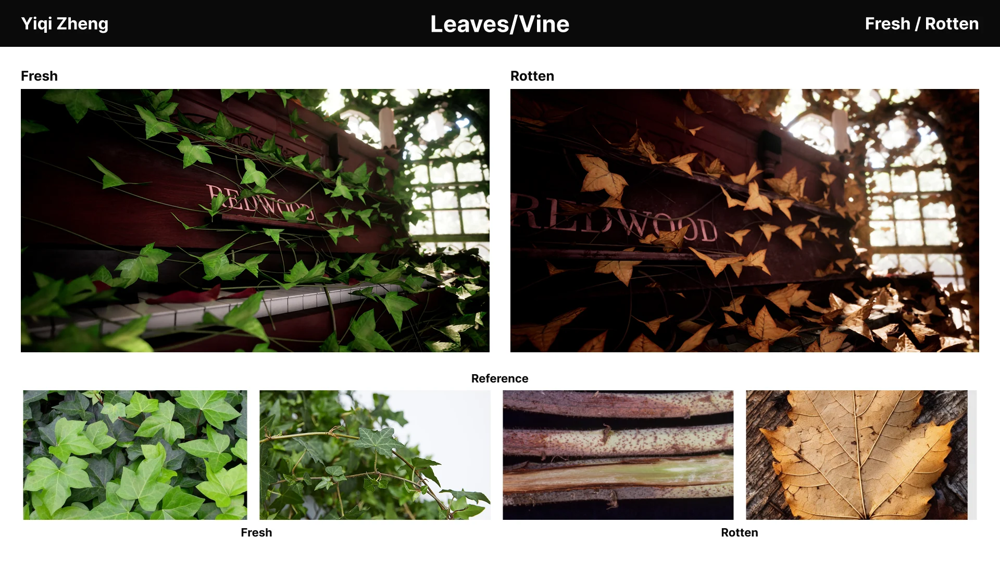

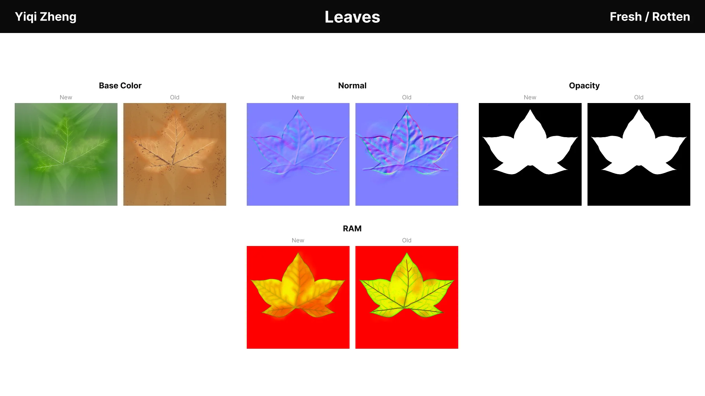

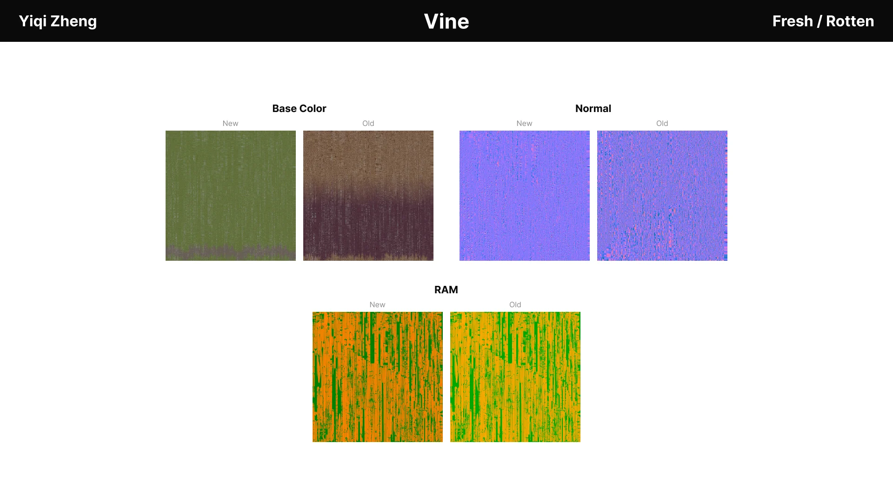

## Moss

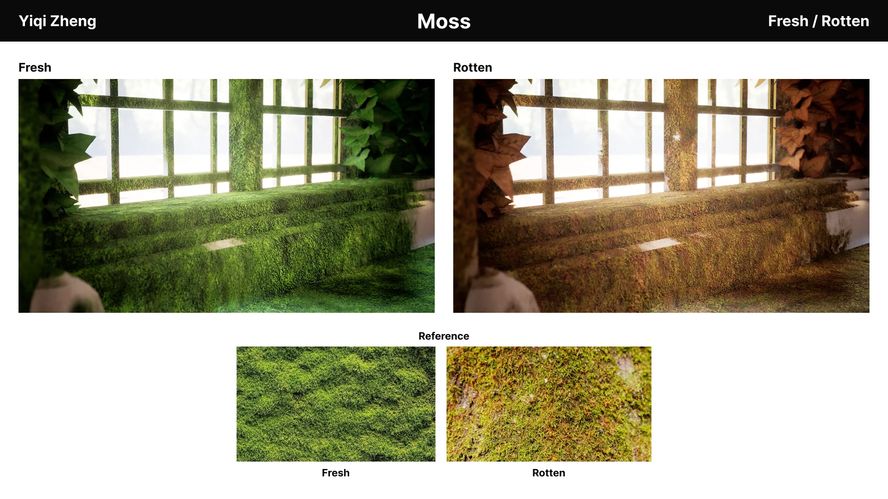

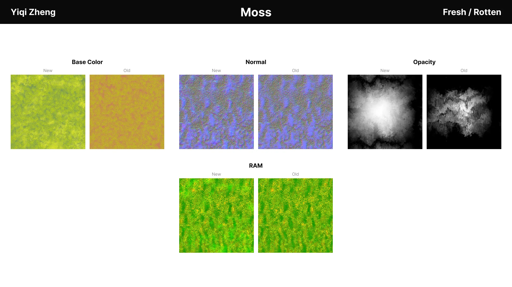

## Pumpkin

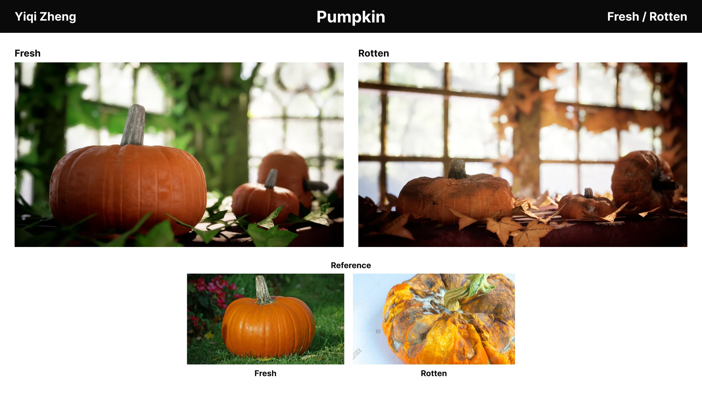

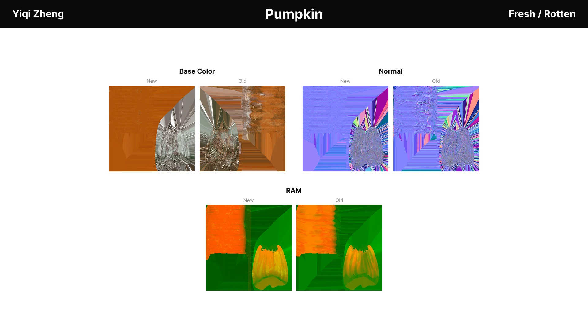

## Rose Petal

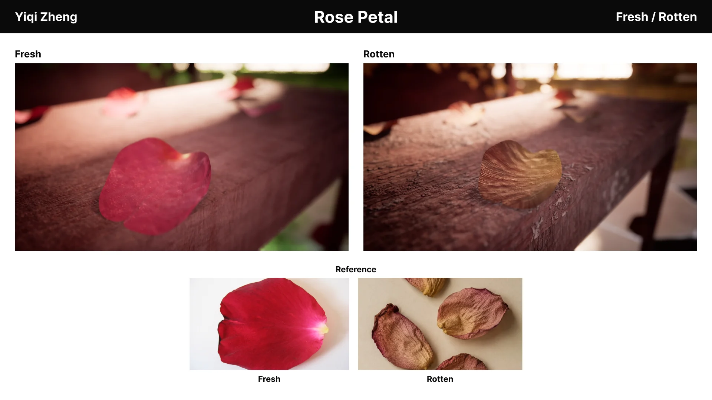

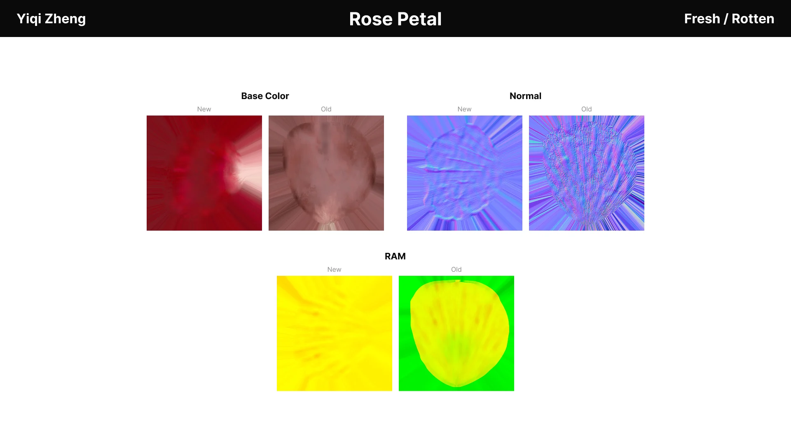
