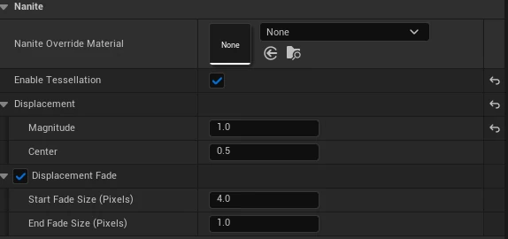
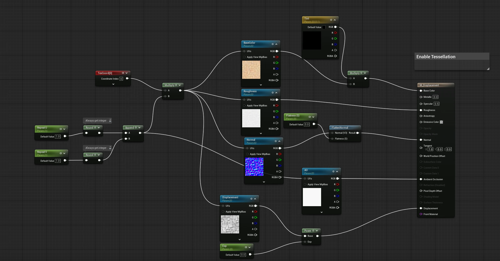
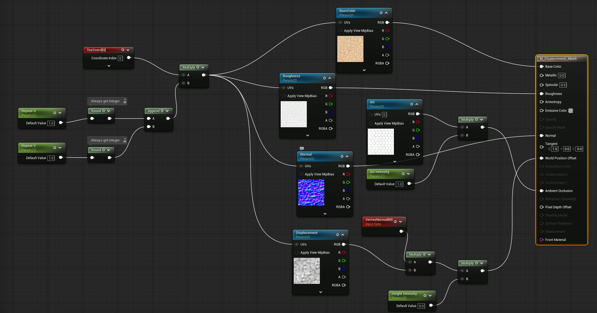

## Substance Designer → Unreal Engine

四個在 **Substance Designer** 中完全程序化製作的材質。每一個形狀、顏色和磨損都由開放的參數控制，同一個節點圖就能變出一整組不同的外觀，再把貼圖帶進 **Unreal Engine**，用真實的幾何位移呈現。

stats: 4 種材質 | 43 個開放參數 | 2048 px 貼圖解析度 | 5 張貼圖／每個材質

### 參數動起來

拖動一個滑桿，整個材質就會重新生成：石塊數量、錯位、灰縫寬度、邊緣磨損和顏色，一格一格渲染出來。

::: switch
石路 | materials/params-rockpath.mp4
磚牆 | materials/params-bricks.mp4
:::

### 自己試試看

選一個材質、選一個參數，然後拖動滑桿。每個位置都是用那個數值真實渲染出來的圓角圓柱，高度貼圖也會跟著改變，所以凹凸會一起變化。

::: params
石路 | 石塊數量 | materials/p/rockpath-stone-count
石路 | 錯位 | materials/p/rockpath-row-offset
石路 | 石塊大小 | materials/p/rockpath-stone-size
石路 | 整體色相 | materials/p/rockpath-hue
磚牆 | 磚塊數量 | materials/p/bricks-brick-count
磚牆 | 錯位 | materials/p/bricks-brick-offset
磚牆 | 灰縫寬度 | materials/p/bricks-mortar
磚牆 | 磚塊色相 | materials/p/bricks-hue
木頭 | 木板數量 | materials/p/wood-plank-count
木頭 | 木紋扭曲 | materials/p/wood-grain-warp
木頭 | 木頭色相 | materials/p/wood-hue
木頭 | 飽和度 | materials/p/wood-saturation
泥巴 | 水位 | materials/p/mud-water-level
泥巴 | 泥堆 | materials/p/mud-mounds
泥巴 | 泥流 | materials/p/mud-flow
泥巴 | 凹凸強度 | materials/p/mud-normal
:::

### 最終效果

Substance Designer 的 Iray 渲染，旁邊是 Base Color、Roughness、Height、Normal 和 AO 貼圖。

::: switch
石路 | materials/showcase-rockpath.webp
磚牆 | materials/showcase-bricks.webp
木頭 | materials/showcase-wood.webp
泥巴 | materials/showcase-mud.webp
:::

### 節點圖

::: switch
石路 | materials/graph-rockpath.webp
磚牆 | materials/graph-bricks.webp
木頭 | materials/graph-wood.webp
泥巴 | materials/graph-mud.webp
:::

### Unreal 材質設定

四個材質共用一個主材質，貼圖重複次數開放成 Repeat U／V，所有貼圖都接進同一個節點圖。為了做出真實的凹凸，我試了兩種用高度貼圖推動幾何的方法：

::: tabs
--- A · Nanite Tessellation
- 在 mesh 上開啟 **Nanite Support**。
- 在材質的 Nanite 設定裡勾選 **Enable Tessellation**。
- 把高度貼圖接到 **Displacement**，用 **Magnitude**（Center 設 0.5）調整凸起的高度。

--- B · World Position Offset
- 高度貼圖乘上 **VertexNormalWS** 和 **Height Intensity** 參數。
- 接到 **World Position Offset**。
- mesh 要先細分，頂點不夠的話形狀不會改變。

:::

### Unreal 的 HDRI 光照設定

::: steps
環境球 | 建立一個球體和環境材質：Reflection Vector 接 Rotate About Axis，帶動 HDRI 貼圖接到 Emissive，材質設成 Unlit 和 Two Sided。 | materials/ue-hdri-material.webp
Sky Light | 把 Sky Light 的 Source Type 改成 **SLS Specified Cubemap**，Cubemap 換成你選的 HDR 貼圖。 | materials/ue-hdri-skylight.webp
曝光 | 加一個 **Post Process Volume**，設定曝光。 | materials/ue-hdri-exposure.webp
Ambient Cubemap | 在同一個 Volume 裡，把 HDRI 指定為 **Ambient Cubemap**。 | materials/ue-hdri-ambient.webp
:::
