六個在 **Substance Designer** 中完全程序化製作、並在 **Unreal Engine** 中算圖的材質。每個材質都有兩種狀態，由開放的參數控制：**新鮮**與**腐爛**。同一個節點圖就能從茂盛飽和，老化成乾枯、褪色、腐朽的樣子。每個材質都輸出 Base Color、Normal，以及打包的 RAM 貼圖（Roughness／AO／Metallic），需要時另外輸出 Opacity。

## 仙人掌／玉

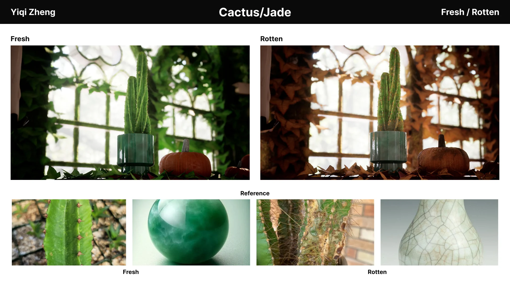

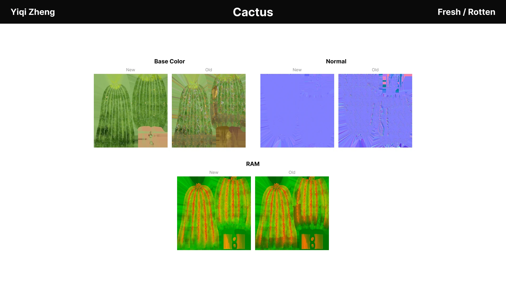

## 葉子／藤蔓

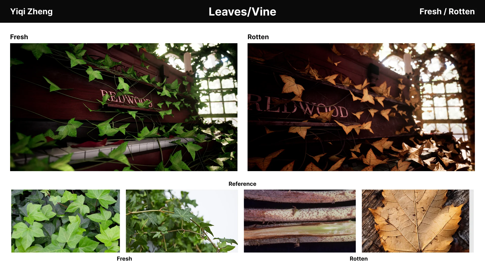

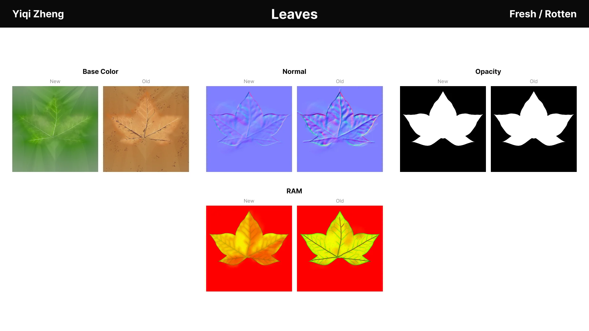

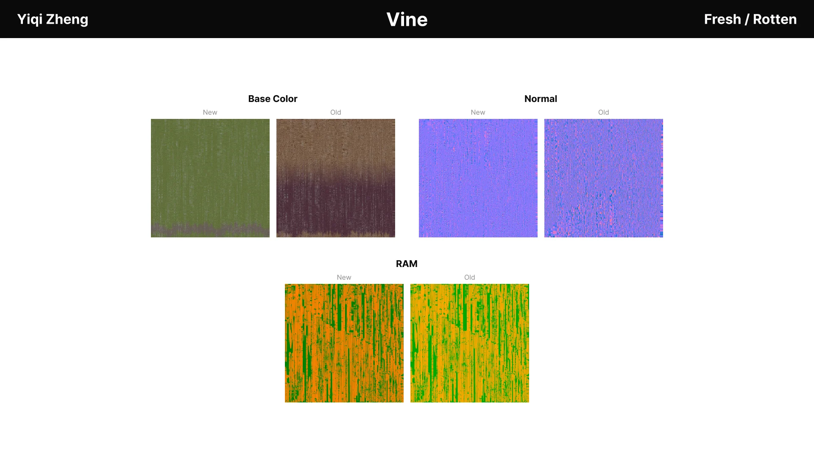

## 苔蘚

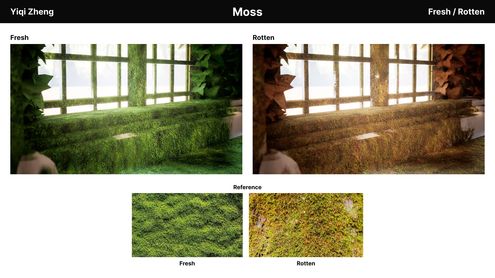

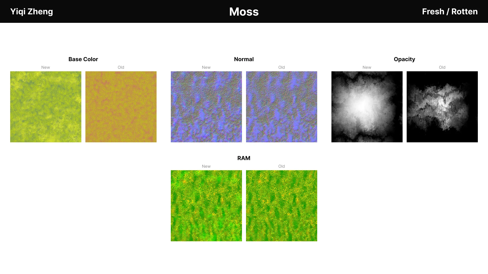

## 南瓜

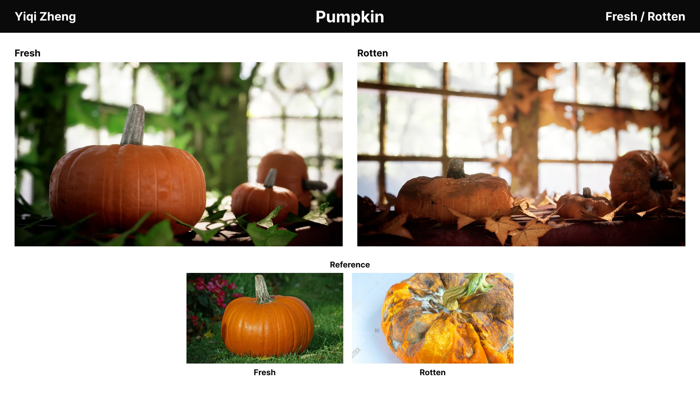

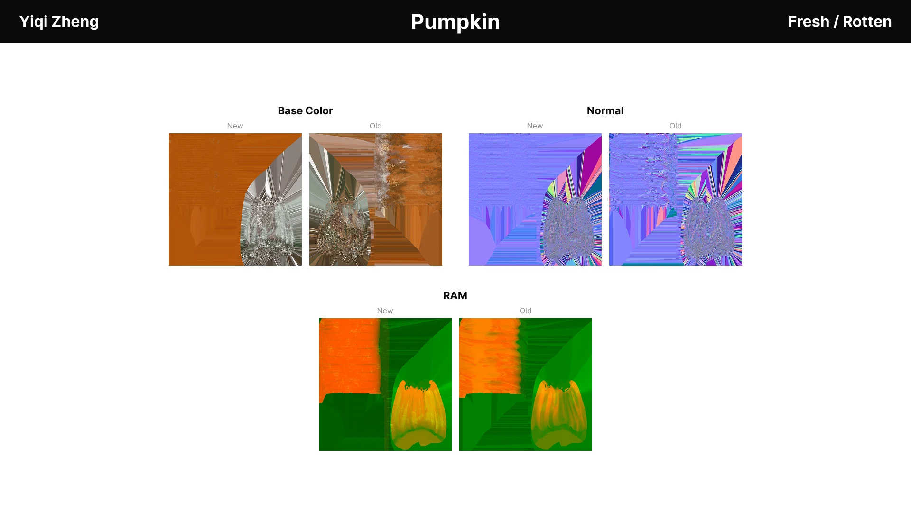

## 玫瑰花瓣

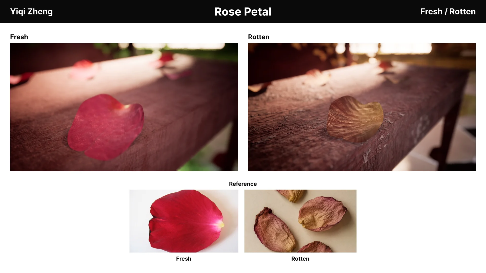

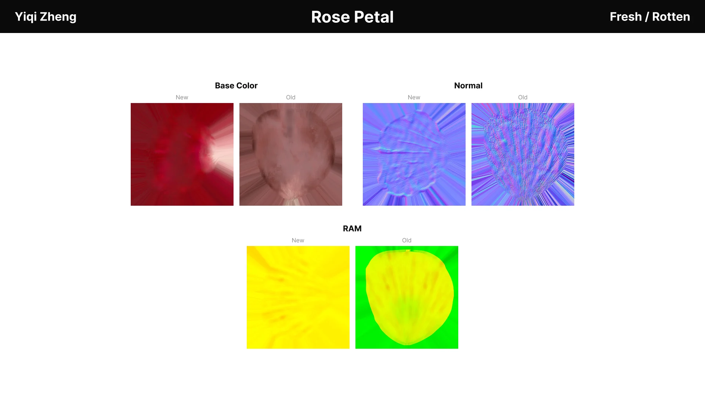
