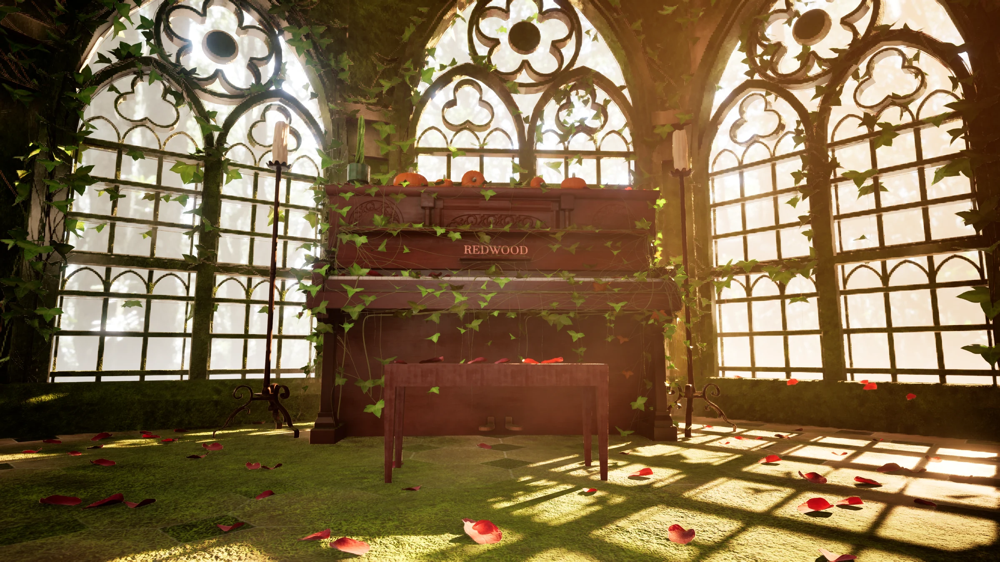

## Substance Designer → Substance Painter → Unreal Engine

Materials for the piano scene, built in **Substance Designer**, hand-finished in **Substance Painter** for the hero props, and assembled in **Unreal Engine**.

stats: 12 Materials | 12 Node graphs | 3 Tools | 1 Final scene

### Final Look: Plants

Substance Designer Iray renders of the organic materials.

::: switch
Cactus | painter/render-cactus.webp
Moss | painter/render-moss.webp
Vine | painter/render-vine.webp
Pumpkin | painter/render-pumpkin.webp
Petal | painter/render-petal.webp
:::

### Final Look: Piano & Surfaces

::: switch
Piano | painter/render-piano.webp
Piano Key | painter/render-piano-key.webp
Copper | painter/render-copper.webp
Window Glass | painter/render-glass.webp
Concrete | painter/render-concrete.webp
Ground Tile | painter/render-tile-ground.webp
:::

### Node Graphs

::: switch
Cactus | painter/graph-cactus.webp
Moss | painter/graph-moss.webp
Leaves | painter/graph-leaves.webp
Vine | painter/graph-vine.webp
Pumpkin | painter/graph-pumpkin.webp
Petal | painter/graph-petal.webp
Piano | painter/graph-piano.webp
Piano Key | painter/graph-piano-key.webp
Copper | painter/graph-copper.webp
Glass | painter/graph-glass.webp
Concrete | painter/graph-concrete.webp
Ground Tile | painter/graph-tile-ground.webp
:::
