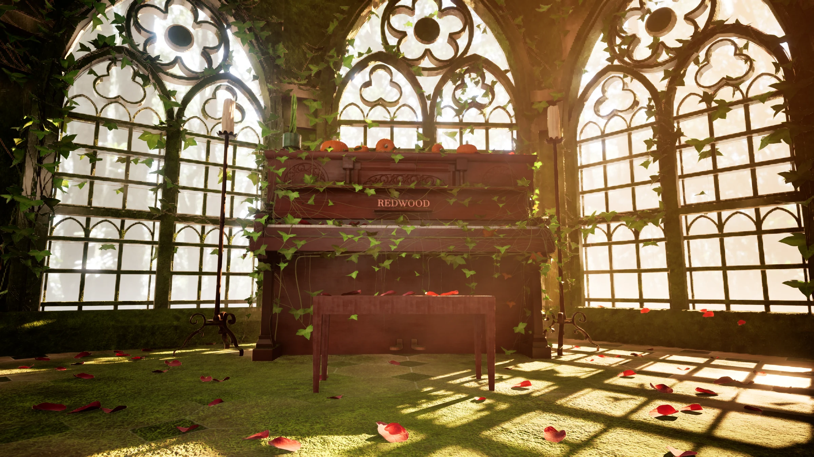

鋼琴場景的材質：先在 **Substance Designer** 程序化製作，主要道具再到 **Substance Painter** 手繪細節，最後在 **Unreal Engine** 組合成完整場景。

stats: 12 種材質 | 12 張節點圖 | 3 個軟體 | 1 個完整場景

### New vs Old

拖動中間的線，比較 Unreal 裡全新乾淨的版本和做舊的材質。

::: switch
鋼琴 | compare New | Old: painter/compare/piano-new.webp | painter/compare/piano-worn.webp
牆 | compare New | Old: painter/compare/wall-new.webp | painter/compare/wall-worn.webp
地磚 | compare New | Old: painter/compare/floor-new.webp | painter/compare/floor-worn.webp
窗戶 | compare New | Old: painter/compare/window-new.webp | painter/compare/window-worn.webp
琴鍵 | compare New | Old: painter/compare/keys-new.webp | painter/compare/keys-worn.webp
:::

### 燈光：Warm vs Cold

同一個鏡頭的兩種打光：左邊暖光，右邊冷光。

::: switch
仙人掌 | compare Warm | Cold: painter/light/cactus-new.webp | painter/light/cactus-old.webp
鋼琴 | compare Warm | Cold: painter/light/piano-new.webp | painter/light/piano-old.webp
南瓜 | compare Warm | Cold: painter/light/pumpkin-new.webp | painter/light/pumpkin-old.webp
苔蘚 | compare Warm | Cold: painter/light/moss-new.webp | painter/light/moss-old.webp
花瓣 | compare Warm | Cold: painter/light/petal-new.webp | painter/light/petal-old.webp
:::

### Fresh vs Rotten

同一套材質的兩種狀態：拖動中間的線，看整個房間從新鮮變成腐爛。

::: switch
房間 | compare Fresh | Rotten: painter/rot/room-fresh.webp | painter/rot/room-rotten.webp
仙人掌 | compare Fresh | Rotten: painter/rot/cactus-fresh.webp | painter/rot/cactus-rotten.webp
鋼琴 | compare Fresh | Rotten: painter/rot/piano-fresh.webp | painter/rot/piano-rotten.webp
南瓜 | compare Fresh | Rotten: painter/rot/pumpkin-fresh.webp | painter/rot/pumpkin-rotten.webp
苔蘚 | compare Fresh | Rotten: painter/rot/moss-fresh.webp | painter/rot/moss-rotten.webp
花瓣 | compare Fresh | Rotten: painter/rot/petal-fresh.webp | painter/rot/petal-rotten.webp
:::

## 有機材質

植物和自然表面：仙人掌、苔蘚、葉子、藤蔓、南瓜和花瓣。

### 參數動起來

每個開放的參數從範圍的一端拉到另一端，一格一格渲染出來。

::: switch
有機材質 | painter/params-organic.mp4
:::

### 自己試試看

選一個材質、選一個參數，然後拖動滑桿。每個位置都是用那個數值真實渲染出來的。

::: params
仙人掌 | 仙人掌色相 | painter/p/cactus-hue
仙人掌 | 亮部 | painter/p/cactus-highlight
仙人掌 | 斑點顏色 | painter/p/cactus-spot
葉子 | 新鮮度 | painter/p/leaves-freshness
葉子 | 飽和度 | painter/p/leaves-saturation
葉子 | 褪色 | painter/p/leaves-paleness
葉子 | 葉片色相 | painter/p/leaves-hue
葉子 | 葉脈顏色 | painter/p/leaves-veins
葉子 | 葉柄色相 | painter/p/leaves-stem
苔蘚 | 苔蘚不透明度 | painter/p/moss-opacity
苔蘚 | 綠度 | painter/p/moss-green
苔蘚 | 苔蘚色相 | painter/p/moss-hue
苔蘚 | 細節色調 | painter/p/moss-detail
苔蘚 | 凹凸強度 | painter/p/moss-relief
苔蘚 | 隨機變化 | painter/p/moss-seed
南瓜 | 紋路數量 | painter/p/pumpkin-ribs
南瓜 | 成熟度 | painter/p/pumpkin-ripeness
南瓜 | 條紋 | painter/p/pumpkin-stripes
南瓜 | 紋路深度 | painter/p/pumpkin-ribdepth
藤蔓 | 顏色漸層 | painter/p/vine-gradient
藤蔓 | 藤蔓流動 | painter/p/vine-flow
藤蔓 | 斑駁程度 | painter/p/vine-patch
藤蔓 | 樹皮色相 | painter/p/vine-bark
花瓣 | 花瓣色相 | painter/p/petal-hue
花瓣 | 邊緣色調 | painter/p/petal-edge
花瓣 | 紋理深度 | painter/p/petal-vein
:::

### 最終效果

::: switch
仙人掌 | painter/render-cactus.webp
苔蘚 | painter/render-moss.webp
藤蔓 | painter/render-vine.webp
南瓜 | painter/render-pumpkin.webp
花瓣 | painter/render-petal.webp
:::

### 節點圖

::: switch
仙人掌 | painter/graph-cactus.webp
苔蘚 | painter/graph-moss.webp
葉子 | painter/graph-leaves.webp
藤蔓 | painter/graph-vine.webp
南瓜 | painter/graph-pumpkin.webp
花瓣 | painter/graph-petal.webp
:::

## 非有機材質

鋼琴和周圍的空間：烤漆木頭、琴鍵、銅、玻璃、混凝土和地磚。

### 參數動起來

每個開放的參數從範圍的一端拉到另一端，一格一格渲染出來。

::: switch
非有機材質 | painter/params-hard.mp4
:::

### 自己試試看

選一個材質、選一個參數，然後拖動滑桿。每個位置都是用那個數值真實渲染出來的。

::: params
鋼琴 | 雕花大小 | painter/p/piano-ornament
鋼琴 | 雕刻柔和度 | painter/p/piano-carving
鋼琴 | 木頭色相 | painter/p/piano-hue
鋼琴 | 磨損 | painter/p/piano-wear
鋼琴 | 深色紋路 | painter/p/piano-streaks
琴鍵 | 琴鍵色調 | painter/p/keys-tone
銅 | 金屬色相 | painter/p/copper-hue
窗戶玻璃 | 窗格數量 | painter/p/glass-panes
窗戶玻璃 | 顏色變化 | painter/p/glass-variation
混凝土 | 污漬 | painter/p/concrete-stains
混凝土 | 混凝土色相 | painter/p/concrete-hue
混凝土 | 暖色斑塊 | painter/p/concrete-warm
地磚 | 地磚數量 | painter/p/tile-tiles
地磚 | 髒污 | painter/p/tile-dirt
地磚 | 縫隙寬度 | painter/p/tile-grout
地磚 | 地磚色相 | painter/p/tile-hue
地磚 | 凹凸強度 | painter/p/tile-relief
:::

### 最終效果

::: switch
鋼琴 | painter/render-piano.webp
琴鍵 | painter/render-piano-key.webp
銅 | painter/render-copper.webp
玻璃 | painter/render-glass.webp
混凝土 | painter/render-concrete.webp
地磚 | painter/render-tile-ground.webp
:::

### 節點圖

::: switch
鋼琴 | painter/graph-piano.webp
琴鍵 | painter/graph-piano-key.webp
銅 | painter/graph-copper.webp
玻璃 | painter/graph-glass.webp
混凝土 | painter/graph-concrete.webp
地磚 | painter/graph-tile-ground.webp
:::
